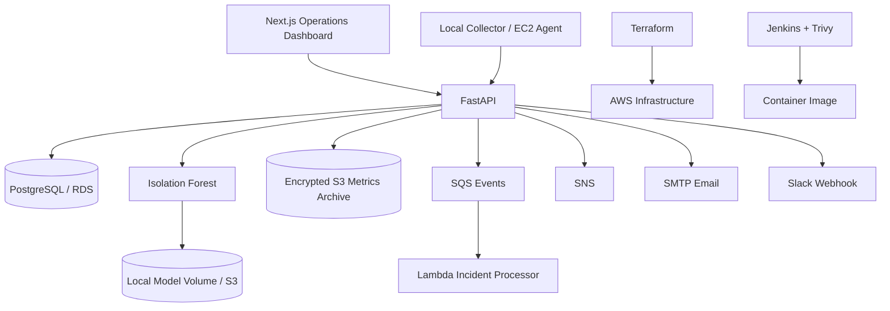

# CloudPulse Sentinel

**Cloud infrastructure monitoring, anomaly detection and incident response platform**

CloudPulse Sentinel is an AIOps-style monitoring capstone built with FastAPI, PostgreSQL, scikit-learn, Next.js, Docker, AWS services, Terraform and Jenkins.

## Capabilities

- Resource telemetry for CPU, memory and disk, plus API latency, error rate and request rate.
- Periodic local collection in Docker Compose and authenticated per-instance remote metric ingestion.
- Fleet inventory, per-instance filtering and historical utilization charts.
- Configurable warning/critical thresholds for CPU, memory and disk.
- Incident creation, duplicate suppression, automatic recovery resolution, acknowledgement, manual resolution and event timelines.
- Isolation Forest training, local or S3 model persistence, model metadata, anomaly history and authorized retraining.
- Cost/utilization recommendations based on observed CPU and memory history. These are utilization recommendations, not live bill estimates.
- Incident delivery through optional SNS, SMTP email (critical incidents) and Slack webhook integrations, with delivery-attempt history.
- Optional encrypted S3 raw metric archival and SQS metric events for Lambda processing, with a dead-letter queue in Terraform.
- JWT authentication and role-based access for operator actions.
- Jenkins pipeline, Trivy image scanning, Terraform infrastructure and a responsive dark operations dashboard.

## Architecture



## Repository layout

- `app/` — FastAPI routes, authentication, anomaly detection, incidents, notifications, S3/SQS integrations and migrations.
- `cloudpulse-dashboard/` — Next.js responsive operations dashboard.
- `infrastructure/terraform/` — AWS VPC, EC2, RDS, IAM, S3, SQS, Lambda and SNS resources.
- `scripts/` — SQL bootstrap, local collector, remote EC2 agent, metric utilities and demos.
- `tests/` — API, incident, ML, notification, remediation and Lambda tests.
- `docs/` — architecture, API reference, security and submission runbooks.

## Local Docker Compose quick start

Requirements: Docker Desktop with WSL integration enabled.

```bash
cp .env.example .env
openssl rand -hex 32
vim .env
```

Set at least `DB_PASSWORD` and `JWT_SECRET_KEY` (32+ random characters). For a local-only run, leave the AWS bucket/queue/topic, SMTP and Slack values blank; local model persistence uses the `ml_models` volume. Generate `METRICS_INGEST_TOKEN` with `openssl rand -hex 32` if you want to use remote instance agents.

Start the stack:

```bash
docker compose up -d --build
docker compose ps
```

Open:

- Dashboard: <http://localhost:3001>
- API docs: <http://localhost:8000/docs>
- Health check: <http://localhost:8000/health>

The Compose stack includes PostgreSQL, FastAPI, a local periodic metrics collector, and the Next.js dashboard. The collector records a local Docker/container environment sample every 30 seconds by default. Change `COLLECTION_INTERVAL_SECONDS` in `.env` to adjust the interval (minimum 10 seconds).

Tail collection logs:

```bash
docker compose logs -f metrics-collector
```

Runtime schema upgrades are additive and idempotent; they run when the backend starts. Compose pins the project name to `cloudpulse-sentinel` so the existing `cloudpulse-sentinel_postgres_data` and `cloudpulse-sentinel_ml_models` volumes are reused even if the extracted folder is named differently. **Do not use `docker compose down -v`** unless you intentionally want to delete the database and model volumes.

## Dashboard actions and demo accounts

The dashboard is readable without signing in. Sign in to acknowledge/resolve incidents or retrain the model.

The SQL bootstrap seeds demonstration accounts:

| Role | Username | Password |
|---|---|---|
| Administrator | `admin` | `admin123` |
| Analyst | `analyst` | `analyst123` |

These are demo-only credentials inserted by the SQL bootstrap only when PostgreSQL initializes an empty data directory. An existing persistent `postgres_data` volume keeps its current users and password hashes; the credentials above may therefore not match an already-running installation. Replace demo credentials before any shared or production deployment. Threshold settings require the admin role; incident actions and ML retraining require analyst or admin.

## Multi-instance EC2 monitoring

The dashboard can display multiple reporting instances. Deploy `scripts/instance_agent.py` on each monitored EC2 host. The agent reads EC2 instance metadata using IMDSv2 (or uses `INSTANCE_ID`) and sends CPU, memory and disk readings to the central API.

On each monitored host, install Python 3 and `psutil`, then configure:

```bash
export CLOUDPULSE_INGEST_URL="https://YOUR-CLOUDPULSE-HOST/api/v1/metrics/ingest"
export METRICS_INGEST_TOKEN="THE_SAME_RANDOM_TOKEN_CONFIGURED_ON_THE_BACKEND"
export COLLECTION_INTERVAL_SECONDS=30  # optional; minimum 10 seconds
python3 instance_agent.py
```

The agent runs continuously and sends a new sample each interval. Run it under `systemd` or another process supervisor on a long-lived host; stop it with `Ctrl+C` during a foreground demo.

The backend must have the same `METRICS_INGEST_TOKEN` value. Protect the API with TLS and network restrictions before exposing it. A single shared token is a simple project/demo agent credential; use per-agent credentials or an authenticated agent identity service for production.

## Email, Slack and AWS integrations

All providers are optional and are disabled when their settings are blank.

| Integration | Backend configuration | Behavior |
|---|---|---|
| SNS | `CLOUDPULSE_SNS_TOPIC_ARN`, `AWS_REGION` | Publishes incident events to the configured topic. Confirm SNS subscriptions separately. |
| Email | `SMTP_HOST`, `SMTP_PORT`, `SMTP_USERNAME`, `SMTP_PASSWORD`, `SMTP_FROM`, `SMTP_TO`, `SMTP_STARTTLS` | Email delivery is attempted for critical incidents only. |
| Slack | `SLACK_WEBHOOK_URL` | Posts incident summaries to an incoming webhook. |
| S3 raw archive | `METRICS_ARCHIVE_BUCKET`, `AWS_REGION` | Stores encrypted, date/instance-partitioned metric JSON objects. |
| S3 ML model | `ML_MODEL_BUCKET`, `AWS_REGION` | Loads/saves the model artifact. Local persistent volume is used when no bucket is configured. |
| SQS + Lambda | `CLOUDPULSE_SQS_QUEUE_URL`, `AWS_REGION` | Publishes metric events; the Terraform Lambda event source mapping processes queue messages. |

Never commit `.env`, webhook URLs, SMTP passwords, AWS keys, `terraform.tfvars`, Terraform state, private keys or JWT secrets. Prefer an EC2 instance profile over static AWS access keys. Only load ML pickle artifacts from storage writable by trusted operators.

## Backend development

```bash
python3.12 -m venv .venv
source .venv/bin/activate
python -m pip install --upgrade pip
pip install -r requirements-dev.txt
cp .env.example .env
vim .env
```

For direct local development, configure a reachable PostgreSQL database with `DB_HOST`, `DB_PORT`, `DB_NAME`, `DB_USER`, `DB_PASSWORD` and `JWT_SECRET_KEY`. Start the API:

```bash
set -a; source .env; set +a
uvicorn app.main:app --host 0.0.0.0 --port 8000 --reload
```

The backend runs the additive feature migrations during startup. You can also initialize a new database using `scripts/init_database.sql`.

## Dashboard development

```bash
cd cloudpulse-dashboard
npm ci
cp .env.example .env.local
vim .env.local
npm run dev
```

Set `BACKEND_URL=http://localhost:8000`. Open <http://localhost:3000> for the standalone Next.js dev server. Compose maps the production dashboard container to port `3001`.

## AWS infrastructure

Review `infrastructure/terraform/variables.tf`. Copy `infrastructure/terraform/terraform.tfvars.example` to `terraform.tfvars`, replace placeholders, and keep the real file untracked. Restrict `admin_cidr` to a trusted address range. Review the plan and AWS costs before applying anything.

```bash
terraform -chdir=infrastructure/terraform init
terraform -chdir=infrastructure/terraform fmt -check -recursive
terraform -chdir=infrastructure/terraform validate
terraform -chdir=infrastructure/terraform plan -var-file=terraform.tfvars
```

Build the Lambda deployment artifact before Terraform validation/planning because the Lambda resource references `incident_processor.zip`:

```bash
scripts/build_lambda_package.sh
```

After provisioning, use Terraform outputs for the queue URL, SNS topic ARN, model bucket and archive bucket. No AWS resources are created by running the local Compose stack. Do not run `terraform apply` or destroy resources without reviewing the target account, region, plan and costs.

## Validation

```bash
python -m compileall -q app scripts tests
python -m pytest -q
pip-audit -r app/requirements.txt
cd cloudpulse-dashboard && npm ci && npm run lint && npm run build
```

Also run Terraform formatting/validation and a controlled AWS integration check where AWS resources are configured. Unit tests use mocks for cloud services; successful local tests do not prove live SNS, SMTP, Slack, S3, SQS, EC2, RDS or Lambda delivery. In Jenkins, EC2 deployment is opt-in (`DEPLOY_TO_EC2`, default `false`) and uses job parameters for the host and Jenkins SSH credential ID; CI validation does not automatically deploy to a fixed server.

## Known limitations to disclose

- Local Docker metrics describe the local container environment, not an EC2 host. Use the remote agent on each EC2 instance to report its own metrics.
- Memory/disk metrics are collected by the per-instance agent; CloudWatch agent metrics are not currently used.
- Notification delivery requires valid provider configuration and permission. A `skipped` history entry means that channel is not configured.
- Cost output is utilization-based guidance, not a live AWS cost/savings calculation.
- Isolation Forest quality depends on training data; a small demo dataset does not establish production accuracy.
- The current remote agent uses a shared ingest token. Use per-agent identities, TLS, and network controls for production.
- The Terraform topology and application still need a TLS-terminating ingress and production secrets management before public exposure.
