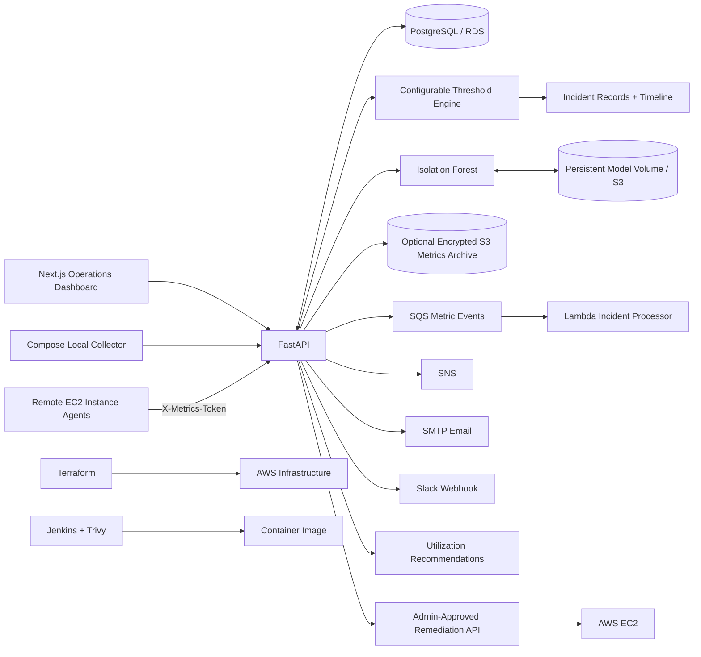

# CloudPulse Sentinel Architecture

## Data flow

1. The Compose local collector calls the backend collector periodically. The backend process collects its local container/runtime view and records the `local-docker` identity when EC2 metadata is unavailable.
2. Each remote EC2 agent collects CPU, memory and disk host metrics with `psutil`, discovers its EC2 instance ID through IMDSv2, and sends telemetry using `X-Metrics-Token`.
3. FastAPI stores metrics in PostgreSQL, evaluates configured warning/critical thresholds, resolves incidents after recovery and records incident timeline events.
4. When a trained model is available, Isolation Forest scores incoming metric vectors. Three consecutive anomalous detections are required before an ML anomaly incident is created.
5. Incident delivery attempts are made through configured SNS, SMTP email and Slack providers. Attempts are stored in `notification_history` as sent, failed or skipped.
6. Metrics are optionally archived to encrypted S3 objects and metric events are optionally published to SQS for Lambda processing.
7. The dashboard reads fleet inventory, instance-filtered telemetry, incidents, timelines, ML metadata, notification history and cost/utilization recommendations.
8. Threshold editing, incident acknowledgement/resolution and model training are role-protected. EC2 remediation remains an explicit admin API and is not represented as an automatic dashboard action.

## Scope boundaries

- Local Docker samples are not EC2 host measurements. Install the instance agent on each EC2 host for per-instance telemetry.
- The instance agent sends CPU, memory and disk metrics; it is not an AWS CloudWatch agent.
- Utilization recommendations are not AWS billing forecasts or guaranteed dollar savings.
- SNS, S3, SQS, Lambda, SMTP and Slack require configuration and live verification in the target environment.
